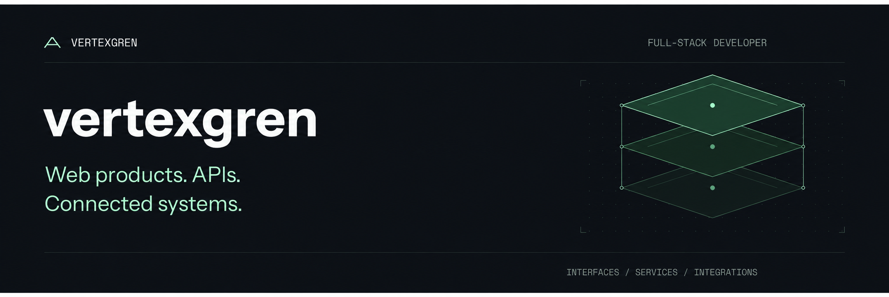

  

  <strong>From interface to integration.</strong> 
  I build web products with Vue / Nuxt, practical backends, and the APIs that connect them.

  <a href="#what-i-build">What I build</a> &nbsp;·&nbsp;
  <a href="#stack">Stack</a> &nbsp;·&nbsp;
  <a href="#open-source">Open source</a>

---

## What I build

- **Web interfaces** — company sites, admin dashboards, form builders, and workflow UIs with Vue / Nuxt.
- **Product backends** — Strapi + PostgreSQL applications and FastAPI services, including speech-to-text pipelines with Yandex SpeechKit.
- **Connected systems** — iikoCloud and external REST API integrations, with Docker and GitHub Actions for delivery.

## Stack

  
  
  
  
  

  
  
  
  
  

## Open source

### [iiko_client_rs ↗](https://github.com/vertexgren/iiko_client_rs)

A Rust client for the **iikoCloud API**, generated with OpenAPI Generator. Covers restaurant workflows including orders, deliveries, reservations, menus, and loyalty.

[Rust source](https://github.com/vertexgren/iiko_client_rs) &nbsp;·&nbsp; [API documentation](https://github.com/vertexgren/iiko_client_rs/tree/main/docs)

---

  Interfaces · Services · Integrations 
  <a href="https://github.com/vertexgren?tab=repositories">Explore my repositories ↗</a>

